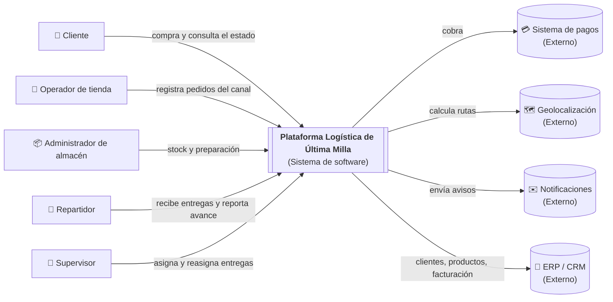
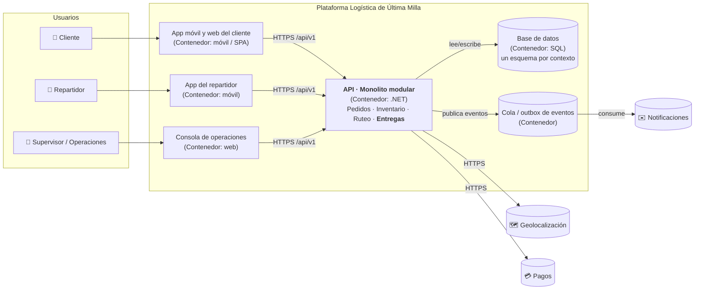
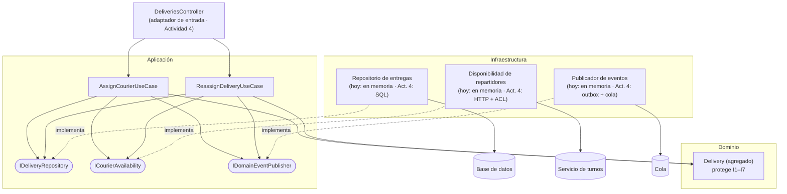

# Architecture.md · Plataforma logística de última milla

> Documento de entrada al proyecto (videos 002 y 019). Resume **lo que necesitas saber para entender y modificar el sistema sin adivinar**. Las decisiones detalladas están en los ADR de [`docs/adr`](docs/adr).

## 1. Qué problema resuelve y quién lo usa

Una empresa de retail digital recibe pedidos por varios canales, con inventario distribuido y entregas con distintas rutas y repartidores. **No tiene una vista centralizada del estado real de cada pedido** ([Actividad 1](docs/actividad-1/01-resumen-ejecutivo.md)).

La plataforma centraliza el ciclo del pedido: registrar, reservar inventario, estimar la ruta, asignar el repartidor y entregar.

- **Usuarios:** cliente, operador de tienda, administrador de almacén, repartidor, soporte y supervisor de operaciones.
- **Sistemas externos:** pagos, geolocalización, notificaciones y ERP/CRM.

## 2. Estilo de arquitectura

- **Monolito modular** ([ADR-001](docs/adr/ADR-001-monolito-modular.md)). Hay un solo despliegue, con cuatro contextos de negocio separados por contratos: **Pedidos, Inventario, Ruteo y Entregas**.
- **Dentro de cada contexto: arquitectura limpia de tres capas** (Dominio, Aplicación e Infraestructura), con **puertos y adaptadores** ([ADR-002](docs/adr/ADR-002-dominio-entregas-puertos-adaptadores.md)).
- **Contexto ya diseñado: Entregas**, con el flujo **asignar una entrega** ([Actividad 3](docs/actividad-3/01-flujo-asignar-entrega.md)). Los demás contextos siguen la misma estructura cuando se construyan.

## 3. Diagramas C4

### Nivel 1 · Contexto



### Nivel 2 · Contenedores



> En C4, un "contenedor" es una aplicación o un almacén de datos que se ejecuta por separado. No significa Docker (video 17).

### Nivel 3 · Componentes del contexto Entregas (dentro de la API)



## 4. Estructura del código

```
src/
├── Logistica.Entregas.Domain/          ← reglas del negocio (no depende de nada)
│   ├── Delivery.cs                     ← agregado Entrega + Asignación + estados
│   ├── ValueObjects.cs                 ← DeliveryId, CourierId, DeliveryWindow, CourierCapacity…
│   ├── DomainEvents.cs                 ← CourierAssigned, DeliveryReassigned
│   └── DomainException.cs              ← errores con código
├── Logistica.Entregas.Application/     ← casos de uso, contratos y puertos (depende del Dominio)
│   ├── UseCases/AssignCourierUseCase.cs
│   ├── UseCases/ReassignDeliveryUseCase.cs
│   ├── Contracts.cs
│   └── Ports.cs
└── Logistica.Entregas.Infrastructure/  ← adaptadores (depende de Aplicación)
    └── Adapters.cs
tests/
├── features/asignar-entrega.feature    ← escenarios Dado-Cuando-Entonces
└── Logistica.Entregas.Tests/           ← pruebas de dominio, aplicación y arquitectura
```

**Regla de dependencias:** Infraestructura → Aplicación → Dominio. Nunca al revés. Las pruebas de arquitectura fallan si alguien la rompe.

## 5. Recorrido de una entrega

1. **Pedidos** confirma un pedido y publica `PedidoConfirmado`.
2. **Entregas** crea la `Delivery` en estado *Pendiente de asignación*.
3. El supervisor la asigna: `AssignCourierUseCase` → `Delivery.AssignCourier` → *Asignada*, y se publica `RepartidorAsignado`.
4. El repartidor sale a ruta (*En camino*) y la completa con evidencia (*Entregada*). Si falla (*Fallida*), se puede reprogramar.
5. Si hay una contingencia, se reasigna con un motivo (`EntregaReasignada`).

## 6. Reglas importantes (no romper)

| Regla | Dónde vive |
|---|---|
| Una entrega activa tiene como máximo un repartidor | `Delivery.AssignCourier` |
| No se asigna a un repartidor inactivo o saturado | `Delivery.EnsureCanTakeDelivery` |
| Reasignar exige motivo y cierra la asignación anterior | `Delivery.Reassign` |
| No se completa una entrega sin evidencia | `Delivery.Complete` |
| Los estados finales no cambian | `Delivery.EnsureStatus` |
| Los contextos no comparten entidades ni leen tablas ajenas | Contratos y eventos ([mapa de contextos](docs/actividad-3/05-contextos-y-contratos.md)) |
| La ubicación del repartidor no entra al contexto Entregas | `CourierCapacity` no tiene ubicación ([Actividad 1](docs/actividad-1/06-caso-reasignacion-tormenta.md)) |

## 7. Decisiones

| ADR | Decisión |
|---|---|
| [ADR-001](docs/adr/ADR-001-monolito-modular.md) | Monolito modular con contextos separados y API versionada |
| [ADR-002](docs/adr/ADR-002-dominio-entregas-puertos-adaptadores.md) | Dominio rico en Entregas, tres capas y puertos y adaptadores |

## 8. Cómo ejecutar y probar

Requisito: [.NET SDK 10](https://dotnet.microsoft.com/download).

```bash
dotnet test LogisticaUltimaMilla.slnx
```

Resultado esperado: **26 pruebas correctas**.

| Grupo | Cantidad |
|---|:-:|
| Dominio | 14 |
| Aplicación | 8 |
| Arquitectura | 4 |

## 9. Riesgos y límites pendientes

| Pendiente | Plan |
|---|---|
| Sin persistencia real ni control de concurrencia entre procesos | Actividad 4: repositorio SQL con columna de versión (concurrencia optimista) |
| Disponibilidad de repartidores simulada en memoria | Actividad 4: adaptador HTTP con timeout y capa anticorrupción |
| Eventos solo en memoria | Actividad 4: outbox + cola, para no perder eventos si falla la publicación |
| Sin API HTTP todavía | Actividad 4: controlador que traduce HTTP ↔ contratos de aplicación |
| Términos ambiguos sin confirmar ("asignada", "saturado", evidencia) | Validar con Operaciones ([glosario](docs/actividad-3/02-lenguaje-ubicuo.md)) |
