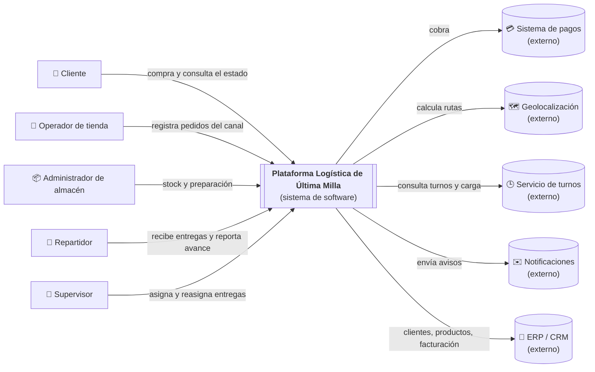
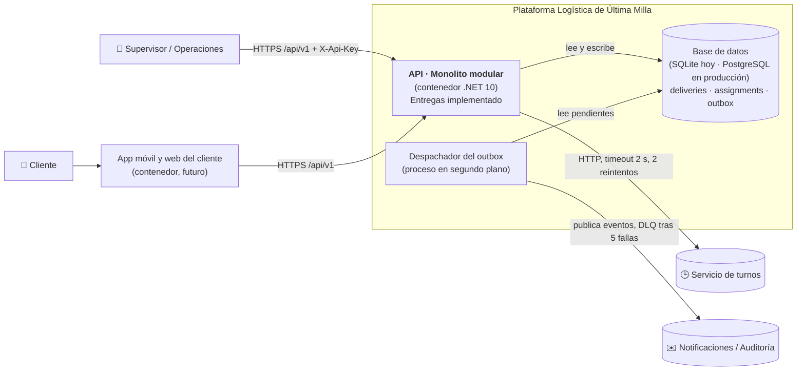
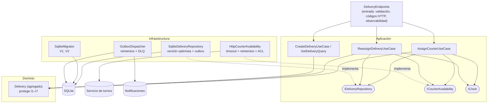

# Architecture.md · Plataforma logística de última milla

> Documento de entrada al proyecto (videos 002 y 019). Resume **lo que necesitas saber para entender y modificar el sistema sin adivinar**. Las decisiones detalladas están en los ADR de [`docs/adr`](docs/adr).

## 1. Qué problema resuelve y quién lo usa

Una empresa de retail digital recibe pedidos por varios canales, con inventario distribuido y entregas con distintas rutas y repartidores. **No tiene una vista centralizada del estado real de cada pedido** ([Actividad 1](docs/actividad-1/01-resumen-ejecutivo.md)).

La plataforma centraliza el ciclo del pedido: registrar, reservar inventario, estimar la ruta, asignar el repartidor y entregar.

- **Usuarios:** cliente, operador de tienda, administrador de almacén, repartidor, soporte y supervisor de operaciones.
- **Sistemas externos:** pagos, geolocalización, notificaciones, ERP/CRM y servicio de turnos de repartidores.

## 2. Estilo de arquitectura

- **Monolito modular** ([ADR-001](docs/adr/ADR-001-monolito-modular.md)). Hay un solo despliegue, con cuatro contextos de negocio separados por contratos: **Pedidos, Inventario, Ruteo y Entregas**.
- **Dentro de cada contexto: arquitectura limpia** (Entrada, Aplicación, Dominio e Infraestructura), con **puertos y adaptadores** ([ADR-002](docs/adr/ADR-002-dominio-entregas-puertos-adaptadores.md)).
- **Implementado de punta a punta: contexto Entregas, flujo "asignar una entrega"** ([Actividad 4](docs/actividad-4/01-implementacion-vertical-slice.md)):
  - API REST;
  - casos de uso;
  - dominio;
  - SQLite con migraciones;
  - outbox con DLQ;
  - adaptador HTTP resiliente ([ADR-003](docs/adr/ADR-003-implementacion-persistencia-integracion.md)).

## 3. Diagramas C4

### Nivel 1 · Contexto



### Nivel 2 · Contenedores



> En C4, un "contenedor" es una aplicación o un almacén de datos que se ejecuta por separado. No significa Docker (video 17).

### Nivel 3 · Componentes del contexto Entregas



## 4. Estructura del código

```
src/
├── Logistica.Entregas.Domain/          ← reglas del negocio (no depende de nada)
├── Logistica.Entregas.Application/     ← casos de uso, contratos y puertos (depende del Dominio)
├── Logistica.Entregas.Infrastructure/  ← adaptadores (depende de Aplicación)
│   ├── Persistence/                    ← SQLite, migraciones V1/V2, repositorio
│   ├── Couriers/                       ← cliente HTTP del servicio de turnos
│   ├── Messaging/                      ← outbox, despachador, DLQ
│   └── Observability/                  ← métricas y trazas
└── Logistica.Entregas.Api/             ← entrada HTTP y composición de dependencias
tests/
├── features/asignar-entrega.feature    ← escenarios Dado-Cuando-Entonces
└── Logistica.Entregas.Tests/           ← dominio, aplicación, infraestructura, API y arquitectura
scripts/demo.ps1                        ← demostración del flujo completo
.github/workflows/ci.yml                ← CI: compilación, SCA y pruebas
```

**Regla de dependencias:** Api → Aplicación + Infraestructura; Infraestructura → Aplicación → Dominio. Nunca al revés. Las pruebas de arquitectura fallan en el CI si alguien la rompe.

## 5. Recorrido de una entrega

1. **Pedidos** confirma un pedido: `POST /api/v1/deliveries` crea la `Delivery` en estado *Pendiente de asignación*.
2. El supervisor la asigna con `POST /api/v1/deliveries/{id}/assignment`:
   - el caso de uso consulta el servicio de turnos;
   - `Delivery.AssignCourier` decide;
   - el repositorio guarda la entrega **y** el evento `RepartidorAsignado` en una transacción.
3. El despachador publica el evento a Notificaciones y Auditoría. Si falla, reintenta; después de 5 fallas lo manda a la DLQ.
4. Si hay una contingencia, se reasigna con un motivo (`EntregaReasignada`).

## 6. Reglas importantes (no romper)

| Regla | Dónde vive |
|---|---|
| Una entrega activa tiene como máximo un repartidor | `Delivery.AssignCourier`, más el índice único `ux_assignments_one_active` |
| No se asigna a un repartidor inactivo o saturado | `Delivery.EnsureCanTakeDelivery` |
| Reasignar exige motivo y cierra la asignación anterior | `Delivery.Reassign` |
| No se completa una entrega sin evidencia | `Delivery.Complete` |
| Los estados finales no cambian | `Delivery.EnsureStatus` |
| Una migración aplicada nunca se edita: se crea `V{n+1}` | `SqliteMigrator` (suma de verificación) |
| La ubicación del repartidor no entra al sistema | `HttpCourierAvailability` (capa anticorrupción) |
| Logs, métricas y eventos sin datos personales | [observabilidad](docs/actividad-4/04-observabilidad.md) |

## 7. Decisiones

| ADR | Decisión |
|---|---|
| [ADR-001](docs/adr/ADR-001-monolito-modular.md) | Monolito modular con contextos separados y API versionada |
| [ADR-002](docs/adr/ADR-002-dominio-entregas-puertos-adaptadores.md) | Dominio rico en Entregas, tres capas y puertos y adaptadores |
| [ADR-003](docs/adr/ADR-003-implementacion-persistencia-integracion.md) | SQLite con migraciones, outbox con DLQ y adaptador HTTP resiliente |

## 8. Cómo ejecutar y probar

Requisito: [.NET SDK 10](https://dotnet.microsoft.com/download).

```bash
dotnet test LogisticaUltimaMilla.slnx                 # todas las pruebas
dotnet run --project src/Logistica.Entregas.Api       # API en http://localhost:5080 (Development)
```

```powershell
./scripts/demo.ps1                                    # en otra terminal: demostración completa
```

| Configuración | Valor por defecto | Producción |
|---|---|---|
| `ConnectionStrings:Entregas` | `Data Source=entregas.db` | Cadena de la base de datos real |
| `Seguridad:ApiKey` | vacía (rechaza todo); `clave-local-solo-desarrollo` en Development | Variable de entorno `Seguridad__ApiKey` |
| `ServicioTurnos:BaseUrl` | simulador local | URL del servicio de turnos |
| `Simulador:Habilitado` | `false`; `true` en Development | `false` |

## 9. Riesgos y límites pendientes

Ver [riesgos residuales y próximos pasos](docs/actividad-4/05-resultados-residuales-proximos-pasos.md). En resumen:
- autenticación con roles (JWT);
- base de datos de producción;
- consumidores idempotentes;
- reproceso de la DLQ;
- exportador de OpenTelemetry;
- DAST.
