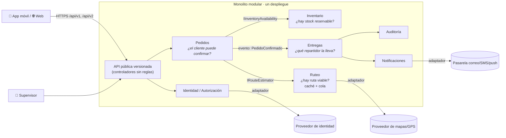

# Plataforma logística · Arquitectura de software

**Optativa II – Fundamentos de Arquitectura de Software**
Estudiante: Maira Torres · Docente: Juan Esteban Angulo

> **Actividad 2 – Requisitos y decisión estructural.** Convertir las necesidades del negocio en requisitos y criterios arquitectónicos, comparar alternativas y justificar una decisión estructural.

🎥 **Video de sustentación:** *[pega aquí el enlace de YouTube / Drive / Teams]*

---

## 1. El problema

La plataforma recibe pedidos desde una **app móvil** y una **web**, reserva inventario, estima rutas y asigna entregas a repartidores. Tres situaciones guían la arquitectura:

| Situación | Por qué importa |
|---|---|
| El negocio quiere agregar una **ventana de entrega** al pedido, pero la app móvil publicada tarda días en actualizarse | Si la API cambia de forma incompatible, **los clientes dejan de crear pedidos** aunque el servidor funcione |
| En campañas de "entregas en menos de 2 horas", las **consultas de ruta se multiplican ×20** | El cálculo de rutas consume CPU y **retrasa la confirmación de todos los pedidos** |
| En una tormenta hay que **reasignar 400 entregas**, y Operaciones pide ver el GPS de los repartidores **sin restricción** | Hay que resolver rápido **sin exponer datos personales** (Ley 1581 de 2012) |

**Actores:** cliente, operador logístico / supervisor, repartidor, soporte, equipo técnico y sistemas externos (mapas/GPS, identidad, notificaciones).

## 2. Requisitos prioritarios

Matriz completa en [02-matriz-priorizacion.md](docs/actividad-2/02-matriz-priorizacion.md).

| Prioridad | Requisito | Medida (escenario de calidad) |
|---|---|---|
| Must · 25 | **RF-02 / RNF-01.** Ventana de entrega opcional sin romper clientes | 100 % de solicitudes v1 sin `deliveryWindow` aceptadas |
| Must · 25 | **RF-03.** Confirmar pedido solo con stock **y** ruta viable | Transacción local, sin inconsistencias |
| Must · 25 | **RNF-03.** Absorber los picos de ruteo ×20 | p95 de crear pedido < 2,2 s durante el pico |
| Must · 20 | **RF-07 / RF-09.** Reasignación masiva con ubicación acotada y auditada | 400 reasignaciones < 10 min; 100 % de accesos auditados |
| Must · 20 | **RNF-02.** Rendimiento al crear pedido | p95 < 2 s con 1.000 pedidos/h |
| Must · 16 | **RNF-11.** Costo proporcional a un equipo pequeño | Un despliegue, una base de datos |

## 3. Decisión arquitectónica

> **Monolito modular** con cuatro contextos de negocio (Pedidos, Inventario, Ruteo, Entregas), **contratos internos** entre módulos, **puertos y adaptadores** para los proveedores externos y una **API pública versionada**. Ruteo usa **caché y cola de trabajo** y queda preparado para extraerse **solo cuando haya evidencia**.

Detalle completo en **[ADR-001](docs/adr/ADR-001-monolito-modular.md)**.



**¿Por qué no microservicios?** El cuello de botella está en **un solo contexto** (Ruteo). Separar los cuatro contextos agregaría red, fallas parciales y costo **sin resolver ese cuello de botella**.

**¿Qué aceptamos?**
- Un despliegue para todo.
- Escalar la app completa durante los picos.
- La disciplina obligatoria de no saltarse los límites entre módulos.

Ruteo se extrae como servicio si se cumplen **tres señales durante dos campañas**: la métrica de rendimiento, un ritmo de despliegue distinto y la capacidad del equipo para operarlo.

## 4. Comparación de alternativas

| Alternativa | Puntaje ponderado |
|---|:-:|
| **A. Monolito modular** ✅ | **4,20** / 5 |
| C. Monolito por capas sin módulos | 3,35 / 5 |
| B. Microservicios por dominio | 2,45 / 5 |

Criterios: complejidad, costo, rapidez, evolución, riesgo operativo, alineación con el negocio y escalabilidad. Ver [04-comparacion-alternativas.md](docs/actividad-2/04-comparacion-alternativas.md).

## 5. Estructura del repositorio

```
.
├── README.md                                 ← este resumen
└── docs/
    ├── actividad-2/
    │   ├── 01-catalogo-requisitos.md         ← actores, alcance, RF, RNF, restricciones
    │   ├── 02-matriz-priorizacion.md         ← MoSCoW + impacto negocio/arquitectura/complejidad
    │   ├── 03-escenarios-calidad.md          ← 10 escenarios con medidas concretas
    │   ├── 04-comparacion-alternativas.md    ← matriz ponderada de 3 alternativas
    │   ├── 05-criterios-verificables.md      ← cómo comprobar que la decisión funciona
    │   └── guion-sustentacion.md             ← guion del video
    └── adr/
        └── ADR-001-monolito-modular.md       ← decisión, opciones, justificación, trade-offs, riesgos
```

## 6. Checklist de la actividad

- [x] Requisitos funcionales claros → [01](docs/actividad-2/01-catalogo-requisitos.md)
- [x] Requisitos no funcionales definidos → [01](docs/actividad-2/01-catalogo-requisitos.md)
- [x] Escenarios de calidad con métricas → [03](docs/actividad-2/03-escenarios-calidad.md)
- [x] Al menos dos alternativas comparadas → [04](docs/actividad-2/04-comparacion-alternativas.md)
- [x] Decisión argumentada con trade-offs → [ADR-001](docs/adr/ADR-001-monolito-modular.md)
- [x] Documento de registro de decisión → [ADR-001](docs/adr/ADR-001-monolito-modular.md)
- [x] Criterios verificables → [05](docs/actividad-2/05-criterios-verificables.md)
- [ ] Video de sustentación entregado (pegar el enlace arriba)

---

> *Regla de oro: la mejor arquitectura es la que se adapta al problema, no la que parece más moderna.*
