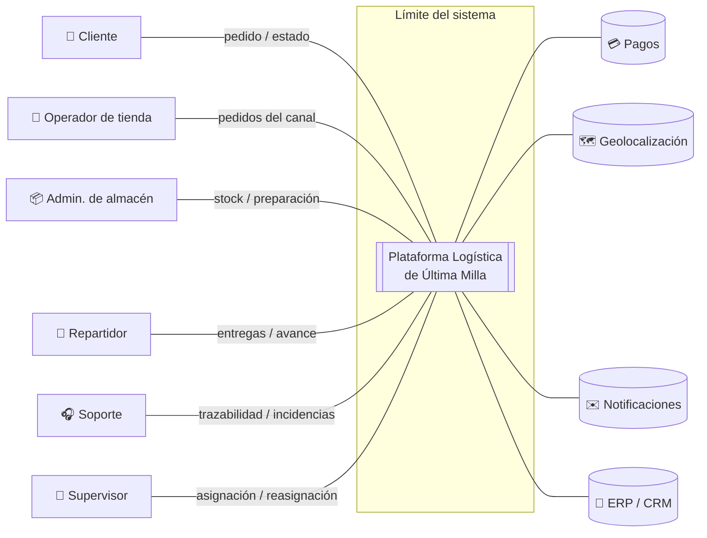
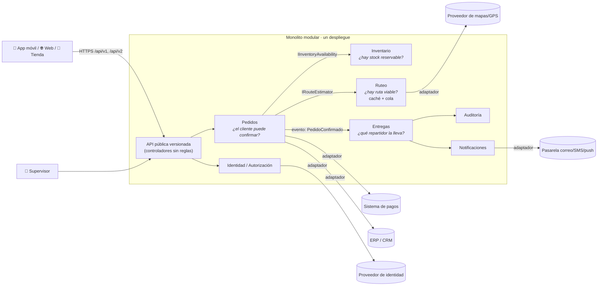
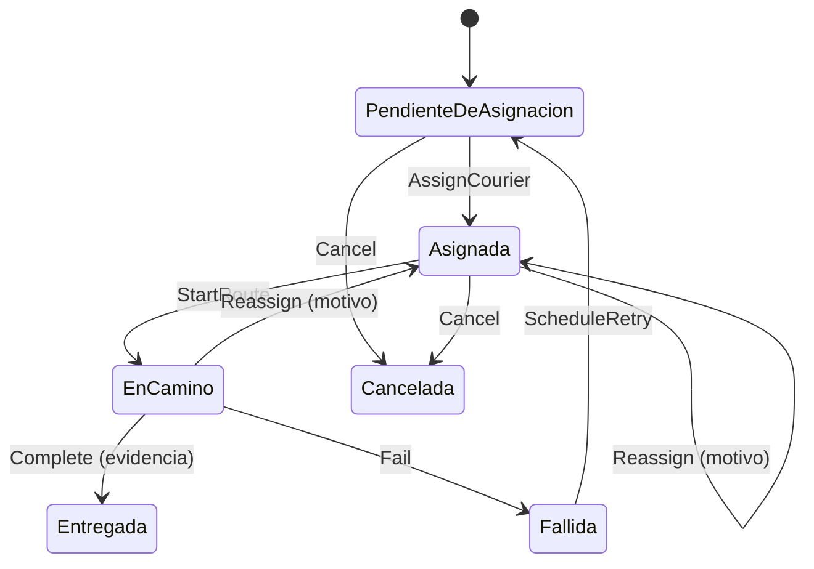
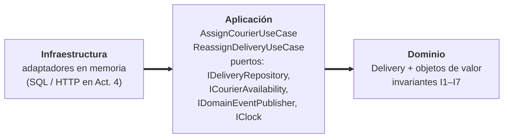

# Plataforma logística de última milla · Arquitectura de software

**Optativa II – Fundamentos de Arquitectura de Software**
Estudiante: Maira Torres · Docente: Juan Esteban Angulo

Este repositorio reúne las entregas del proyecto del curso, en orden.

| Actividad | Tema | Video de sustentación |
|---|---|---|
| [Actividad 1](#actividad-1--diagnóstico-y-contexto-arquitectónico) | Diagnóstico y contexto arquitectónico | 🎥 *[pega aquí el enlace]* |
| [Actividad 2](#actividad-2--requisitos-y-decisión-estructural) | Requisitos y decisión estructural | 🎥 *[pega aquí el enlace]* |
| [Actividad 3](#actividad-3--diseño-y-dominio) | Diseño y dominio | 🎥 *[pega aquí el enlace]* |

📐 **Arquitectura técnica del sistema:** [ARCHITECTURE.md](ARCHITECTURE.md) (diagramas C4, capas, reglas y cómo ejecutar las pruebas).

---

## Actividad 1 · Diagnóstico y contexto arquitectónico

> Comprender el problema **antes** de elegir tecnologías. *"La arquitectura comienza con el contexto, no con el código."*

### El problema

Una empresa de **retail digital** recibe pedidos por **varios canales**, maneja **inventario distribuido** y coordina entregas con **diferentes rutas y repartidores**, pero **no tiene una vista centralizada del estado real de cada pedido**. Esto genera:
- duplicación de información;
- retrasos;
- errores operativos;
- poca trazabilidad.

### Actores

- **Personas:** cliente, operador de comercio o tienda, administrador de almacén, repartidor, soporte al cliente y supervisor de operaciones.
- **Sistemas externos:** sistema de pagos, servicio de geolocalización, sistema de notificaciones y ERP/CRM interno.

### Diagrama de contexto



El detalle de los flujos está en [02-diagrama-contexto.md](docs/actividad-1/02-diagrama-contexto.md).

### Riesgos principales

- **Entregas fallidas o retrasadas.**
- **Duplicación de pedidos e inconsistencias de inventario.**
- **Acceso indebido a la ubicación del repartidor.**
- **Proveedor de mapas lento o caído.**
- **Pérdida de trazabilidad.**

### Decisión inicial

Una **plataforma centralizada** que permita registrar pedidos, validar inventario, asignar rutas, rastrear entregas y gestionar incidencias **desde un único sistema**. Los sistemas externos se integran y quedan aislados, y la ubicación del repartidor se maneja con **privacidad desde el diseño**. Esto último se ve en el [caso de la tormenta](docs/actividad-1/06-caso-reasignacion-tormenta.md).

| Documento | Contenido |
|---|---|
| [01-resumen-ejecutivo.md](docs/actividad-1/01-resumen-ejecutivo.md) | A. Producto, problema, usuarios, objetivos y alcance |
| [02-diagrama-contexto.md](docs/actividad-1/02-diagrama-contexto.md) | B. Diagrama de contexto, flujos y límites |
| [03-analisis-problema.md](docs/actividad-1/03-analisis-problema.md) | C. Qué ocurre hoy, por qué es un problema, consecuencias y variables |
| [04-riesgos.md](docs/actividad-1/04-riesgos.md) | Riesgos con probabilidad, impacto y respuesta inicial |
| [05-supuestos-y-decisiones.md](docs/actividad-1/05-supuestos-y-decisiones.md) | D. Hechos, supuestos, decisiones, lo que no sabemos y lo que hay que confirmar |
| [06-caso-reasignacion-tormenta.md](docs/actividad-1/06-caso-reasignacion-tormenta.md) | Caso de la tormenta: alternativas, decisión, trade-off y verificación |
| [guion-sustentacion.md](docs/actividad-1/guion-sustentacion.md) | Guion del video (5–8 min) |

---

## Actividad 2 · Requisitos y decisión estructural

> Convertir las necesidades del negocio en requisitos y criterios arquitectónicos, comparar alternativas y justificar una decisión estructural.

### Situaciones que guían la arquitectura

| Situación | Por qué importa |
|---|---|
| El negocio quiere agregar una **ventana de entrega** al pedido, pero la app móvil publicada tarda días en actualizarse | Si la API cambia de forma incompatible, **los clientes dejan de crear pedidos** aunque el servidor funcione |
| En campañas de "entregas en menos de 2 horas", las **consultas de ruta se multiplican ×20** | El cálculo de rutas consume CPU y **retrasa la confirmación de todos los pedidos** |
| En una tormenta hay que **reasignar 400 entregas** sin exponer el GPS de los repartidores | Hay que resolver rápido **sin exponer datos personales** (Ley 1581 de 2012) |

### Requisitos prioritarios

Matriz completa en [02-matriz-priorizacion.md](docs/actividad-2/02-matriz-priorizacion.md).

| Prioridad | Requisito | Medida (escenario de calidad) |
|---|---|---|
| Must · 25 | **RF-02 / RNF-01.** Ventana de entrega opcional sin romper clientes | 100 % de solicitudes v1 sin `deliveryWindow` aceptadas |
| Must · 25 | **RF-03.** Confirmar pedido solo con stock **y** ruta viable | Transacción local, sin inconsistencias |
| Must · 25 | **RNF-03.** Absorber los picos de ruteo ×20 | p95 de crear pedido < 2,2 s durante el pico |
| Must · 20 | **RF-07 / RF-09.** Reasignación masiva con ubicación acotada y auditada | 400 reasignaciones < 10 min; 100 % de accesos auditados |
| Must · 20 | **RNF-02.** Rendimiento al crear pedido | p95 < 2 s con 1.000 pedidos/h |
| Must · 16 | **RNF-11.** Costo proporcional a un equipo pequeño | Un despliegue, una base de datos |

### Decisión arquitectónica

> **Monolito modular** con cuatro contextos de negocio (Pedidos, Inventario, Ruteo, Entregas), **contratos internos** entre módulos, **puertos y adaptadores** para los proveedores externos y una **API pública versionada**. Ruteo usa **caché y cola de trabajo** y queda preparado para extraerse **solo cuando haya evidencia**.

Detalle completo en **[ADR-001](docs/adr/ADR-001-monolito-modular.md)**.



**¿Por qué no microservicios?** El cuello de botella está en **un solo contexto** (Ruteo). Separar los cuatro contextos agregaría red, fallas parciales y costo **sin resolver ese cuello de botella**.

**¿Qué aceptamos?**
- Un despliegue para todo.
- Escalar la app completa durante los picos.
- La disciplina obligatoria de no saltarse los límites entre módulos.

Ruteo se extrae como servicio si se cumplen **tres señales durante dos campañas**: la métrica de rendimiento, un ritmo de despliegue distinto y la capacidad del equipo para operarlo.

### Comparación de alternativas

| Alternativa | Puntaje ponderado |
|---|:-:|
| **A. Monolito modular** ✅ | **4,20** / 5 |
| C. Monolito por capas sin módulos | 3,35 / 5 |
| B. Microservicios por dominio | 2,45 / 5 |

| Documento | Contenido |
|---|---|
| [01-catalogo-requisitos.md](docs/actividad-2/01-catalogo-requisitos.md) | Actores, alcance, RF, RNF y restricciones |
| [02-matriz-priorizacion.md](docs/actividad-2/02-matriz-priorizacion.md) | MoSCoW + impacto en negocio, arquitectura y complejidad |
| [03-escenarios-calidad.md](docs/actividad-2/03-escenarios-calidad.md) | 10 escenarios con medidas concretas |
| [04-comparacion-alternativas.md](docs/actividad-2/04-comparacion-alternativas.md) | Matriz ponderada de 3 alternativas |
| [05-criterios-verificables.md](docs/actividad-2/05-criterios-verificables.md) | Cómo comprobar que la decisión funciona |
| [ADR-001](docs/adr/ADR-001-monolito-modular.md) | Decisión, opciones, justificación, trade-offs, riesgos y condición de revisión |
| [guion-sustentacion.md](docs/actividad-2/guion-sustentacion.md) | Guion del video (8–10 min) |

---

## Actividad 3 · Diseño y dominio

> Diseñar el modelo de dominio y los límites de la solución **antes** de construir las integraciones: proteger las invariantes, definir los casos de uso y los contratos, y separar el negocio de la infraestructura.

### Flujo elegido: asignar una entrega

El supervisor asigna una entrega pendiente a un repartidor. El sistema solo la acepta si la entrega no tiene repartidor activo y el repartidor está en turno y no está saturado. Una variante permite reasignar por una contingencia (la tormenta de la Actividad 1), siempre con un motivo.

### Modelo e invariantes

- **Entidad (agregado):** `Delivery`, con la entidad interna `Assignment`.
- **Objetos de valor:**
  - `DeliveryId`, `CourierId`, `OrderReference`;
  - `DeliveryAddress`, `DeliveryWindow`;
  - `CourierCapacity`, `ProofOfDelivery`.
- **Invariantes** (todas dentro de `Delivery`):
  - una entrega activa tiene un solo repartidor;
  - no se asigna a un repartidor saturado o inactivo;
  - reasignar exige un motivo;
  - no se completa una entrega sin evidencia;
  - los estados finales no cambian.



### Capas, puertos y adaptadores



Las dependencias apuntan **hacia adentro**, y las pruebas de arquitectura lo comprueban. Las decisiones y sus trade-offs están en **[ADR-002](docs/adr/ADR-002-dominio-entregas-puertos-adaptadores.md)**.

### Código y pruebas

```bash
dotnet test LogisticaUltimaMilla.slnx
```

Resultado: **26 pruebas correctas**.

| Grupo | Cantidad |
|---|:-:|
| Dominio | 14 |
| Aplicación | 8 |
| Arquitectura | 4 |

Los escenarios Dado-Cuando-Entonces están en [`tests/features/asignar-entrega.feature`](tests/features/asignar-entrega.feature).

| Documento | Contenido |
|---|---|
| [01-flujo-asignar-entrega.md](docs/actividad-3/01-flujo-asignar-entrega.md) | Flujo, actores, propósito y resultado esperado |
| [02-lenguaje-ubicuo.md](docs/actividad-3/02-lenguaje-ubicuo.md) | Glosario y términos ambiguos por confirmar |
| [03-modelo-dominio.md](docs/actividad-3/03-modelo-dominio.md) | Entidades, objetos de valor, estados y transiciones |
| [04-invariantes-y-escenarios.md](docs/actividad-3/04-invariantes-y-escenarios.md) | Invariantes I1–I7 y escenarios de aceptación |
| [05-contextos-y-contratos.md](docs/actividad-3/05-contextos-y-contratos.md) | Mapa de contextos y contratos que se intercambian |
| [06-casos-uso-puertos-adaptadores.md](docs/actividad-3/06-casos-uso-puertos-adaptadores.md) | Casos de uso, puertos, adaptadores, capas y SOLID |
| [ARCHITECTURE.md](ARCHITECTURE.md) | Diagramas C4 (contexto, contenedores, componentes) y guía técnica |
| [ADR-002](docs/adr/ADR-002-dominio-entregas-puertos-adaptadores.md) | Decisiones de diseño, alternativas descartadas y trade-offs |
| [guion-sustentacion.md](docs/actividad-3/guion-sustentacion.md) | Guion del video |

---

## Estructura del repositorio

```
.
├── README.md
├── ARCHITECTURE.md                     ← arquitectura técnica y diagramas C4
├── LogisticaUltimaMilla.slnx           ← solución .NET
├── src/
│   ├── Logistica.Entregas.Domain/          ← entidades, objetos de valor, invariantes
│   ├── Logistica.Entregas.Application/     ← casos de uso, contratos, puertos
│   └── Logistica.Entregas.Infrastructure/  ← adaptadores
├── tests/
│   ├── features/                       ← escenarios Dado-Cuando-Entonces
│   └── Logistica.Entregas.Tests/       ← pruebas de dominio, aplicación y arquitectura
└── docs/
    ├── actividad-1/      ← diagnóstico y contexto
    ├── actividad-2/      ← requisitos y decisión estructural
    ├── actividad-3/      ← diseño y dominio
    └── adr/              ← registros de decisiones arquitectónicas
```

## Checklist

**Actividad 1**
- [x] Problema definido con claridad
- [x] Usuarios y actores identificados
- [x] Alcance delimitado
- [x] Diagrama de contexto
- [x] Riesgos principales listados
- [x] Supuestos explícitos
- [x] Decisiones iniciales justificadas
- [ ] Video de sustentación entregado

**Actividad 2**
- [x] Requisitos funcionales claros
- [x] Requisitos no funcionales definidos
- [x] Escenarios de calidad con métricas
- [x] Al menos dos alternativas comparadas
- [x] Decisión argumentada con trade-offs
- [x] Documento de registro de decisión (ADR)
- [x] Criterios verificables
- [ ] Video de sustentación entregado

**Actividad 3**
- [x] Modelo de dominio definido
- [x] Entidades y objetos de valor diferenciados
- [x] Invariantes listadas
- [x] Lenguaje ubicuo y límites de contexto documentados
- [x] Escenarios de aceptación en Dado-Cuando-Entonces
- [x] Casos de uso principales descritos
- [x] Contratos de aplicación definidos
- [x] Puertos y adaptadores con dependencias dirigidas correctamente
- [x] Diagrama C4 actualizado
- [x] Architecture.md y ADR actualizados
- [x] README actualizado con la propuesta y los diagramas
- [ ] Video de sustentación entregado

---

> *Regla de oro: la mejor arquitectura es la que se adapta al problema, no la que parece más moderna.*
