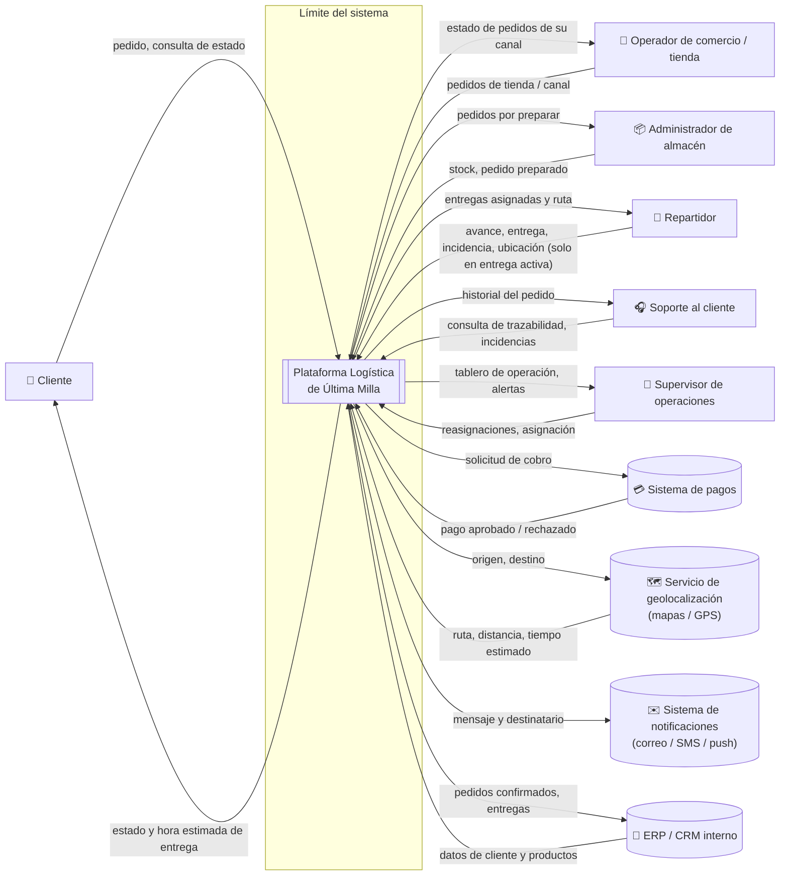

# B. Diagrama de contexto

El diagrama muestra **quién usa el sistema**, **con qué sistemas externos se comunica**, **qué información fluye** y **dónde está el límite** del sistema. Todavía **no muestra tecnologías ni la estructura interna**: eso se decide en la Actividad 2.

## Elementos del diagrama

### Actores (personas)

| Actor | Información que **entrega** al sistema | Información que **recibe** |
|---|---|---|
| Cliente | Pedido, dirección, consulta de estado | Confirmación, estado, hora estimada, avisos de cambio |
| Operador de comercio / tienda | Pedidos de su canal | Estado de esos pedidos |
| Administrador de almacén | Stock disponible, pedido preparado | Pedidos por preparar |
| Repartidor | Avance, entrega realizada, incidencias, **ubicación solo durante una entrega activa** | Entregas asignadas y ruta |
| Soporte al cliente | Consultas, registro de incidencias | Historial y trazabilidad del pedido |
| Supervisor de operaciones | Asignaciones y reasignaciones | Tablero de operación y alertas |

### Sistemas externos

| Sistema | Para qué se usa | Por qué queda **fuera** del límite |
|---|---|---|
| Sistema de pagos | Cobrar el pedido | Es un servicio regulado y especializado; lo contratamos, no lo construimos |
| Servicio de geolocalización | Calcular rutas, distancias y tiempos | Es un proveedor externo que **puede ser lento o caerse**: hay que aislarlo |
| Sistema de notificaciones | Enviar correos, SMS y push | Es infraestructura de terceros |
| ERP / CRM interno | Datos maestros de clientes y productos; facturación y contabilidad | Ya existe en la empresa; la plataforma se integra con él |

## Límites: dentro vs. fuera

| ✅ Dentro (lo construimos) | ❌ Fuera (nos integramos) |
|---|---|
| Registro de pedidos de todos los canales en un solo lugar | Cobro y conciliación de pagos |
| Validación y reserva de inventario | Cálculo de mapas y GPS en sí |
| Asignación de rutas y repartidores | Envío físico de mensajes |
| Seguimiento del estado de la entrega | Facturación, contabilidad, maestro de clientes |
| Incidencias y reasignación en contingencia | Red móvil y dispositivo del repartidor |
| Control de acceso, auditoría y retención de la ubicación | Proveedor de identidad (inicio de sesión) |
