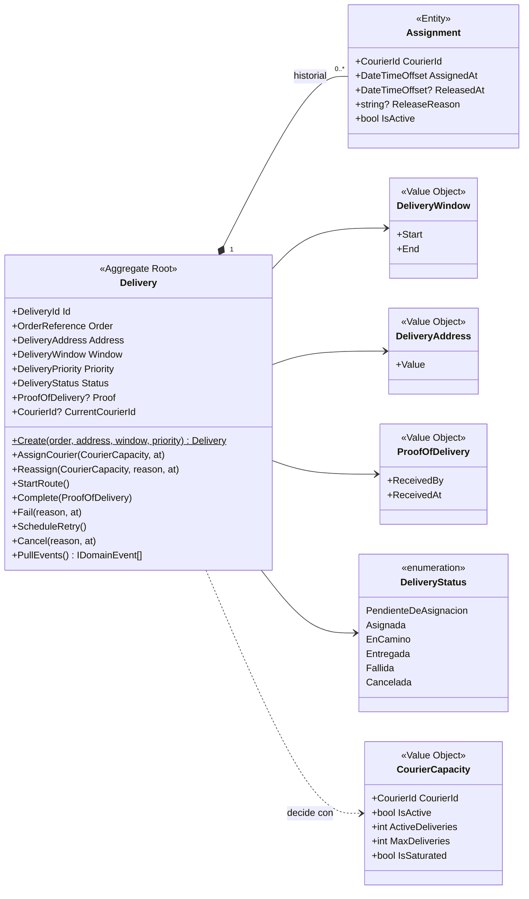
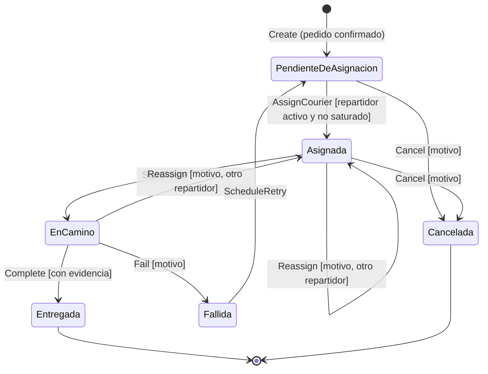

# 3. Modelo de dominio

## Entidades vs. objetos de valor

| Tipo | Elemento | Por qué |
|---|---|---|
| **Entidad (raíz del agregado)** | `Delivery` (Entrega) | Tiene identidad propia: la entrega E-100 sigue siendo E-100 aunque cambie de estado o de repartidor |
| **Entidad interna** | `Assignment` (Asignación) | Tiene ciclo de vida (se abre y se cierra), pero **solo existe dentro de una entrega** y solo se modifica a través de ella |
| Objeto de valor | `DeliveryId`, `CourierId`, `OrderReference` | Identificadores tipados: evitan confundir un Guid de entrega con uno de repartidor |
| Objeto de valor | `DeliveryAddress` | Se describe por su texto; no puede estar vacía |
| Objeto de valor | `DeliveryWindow` | Se describe por inicio y fin; el fin siempre es posterior al inicio |
| Objeto de valor | `DeliveryPriority` | Normal / Urgente |
| Objeto de valor | `CourierCapacity` | **Foto** de la capacidad de un repartidor en un momento: activo, carga activa y máximo |
| Objeto de valor | `ProofOfDelivery` | Quién recibió y cuándo |
| Evento de dominio | `CourierAssigned`, `DeliveryReassigned` | Hechos ya ocurridos que otros contextos necesitan conocer |

> **El agregado `Delivery`.** Es la frontera de consistencia. Todo cambio (asignar, reasignar, completar…) pasa por un método de `Delivery`, que es quien protege las invariantes. Nadie puede agregar una `Assignment` desde fuera.

## Diagrama del modelo

## Estados y transiciones

| Desde | Operación | Hacia | Condición |
|---|---|---|---|
| Pendiente de asignación | `AssignCourier` | Asignada | Sin repartidor activo; repartidor en turno y no saturado |
| Asignada / En camino | `Reassign` | Asignada | Motivo obligatorio; repartidor distinto, en turno y no saturado. Se cierra la asignación anterior |
| Asignada | `StartRoute` | En camino | — |
| En camino | `Complete` | Entregada | Evidencia de recepción obligatoria. Libera al repartidor |
| En camino | `Fail` | Fallida | Motivo obligatorio. Libera al repartidor |
| Fallida | `ScheduleRetry` | Pendiente de asignación | — |
| Pendiente / Asignada | `Cancel` | Cancelada | Motivo obligatorio |
| Entregada / Cancelada | *(cualquiera)* | — | **Estados finales: no cambian** |

Cualquier otra transición se rechaza con el código `ESTADO_NO_PERMITE_OPERACION`.

> **¿Hace falta una máquina de estados en el front-end (video 25)?** No por ahora. Los estados de este flujo viven en el **dominio** y ya están protegidos por la entidad. Una máquina de estados de interfaz tendría sentido en la Actividad 4, si la app del repartidor necesita controlar pantallas (por ejemplo, "escaneando evidencia").

Código: [`src/Logistica.Entregas.Domain/Delivery.cs`](../../src/Logistica.Entregas.Domain/Delivery.cs) y [`ValueObjects.cs`](../../src/Logistica.Entregas.Domain/ValueObjects.cs).
