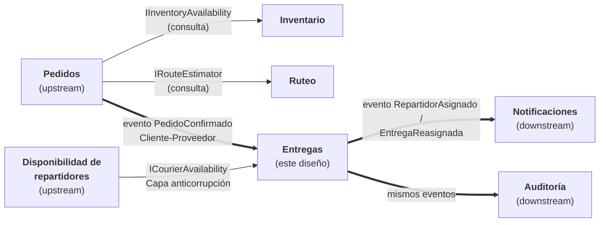

# 5. Contextos delimitados y contratos

## Contextos involucrados

La misma palabra significa cosas distintas en cada contexto (videos 06 y 12.1). Por eso **cada contexto tiene su propio modelo** y **no comparten una entidad `Order` gigante ni leen tablas ajenas**.

| Contexto | Pregunta que responde | Qué significa "disponible" | Responsable |
|---|---|---|---|
| **Pedidos** | ¿El cliente puede confirmar la compra? | — | Equipo de Pedidos |
| **Inventario** | ¿Hay unidades reservables? | Hay stock reservable en una bodega | Equipo de Inventario |
| **Ruteo** | ¿Hay una ruta viable y cuánto tarda? | Hay ruta y capacidad de recorrido | Equipo de Ruteo |
| **Entregas** *(este diseño)* | ¿Qué repartidor lleva esta entrega? | El repartidor está en turno y no está saturado | Operación logística |
| **Disponibilidad de repartidores** | ¿Quién está en turno y con cuánta carga? | — | Operaciones (app del repartidor / turnos) |
| **Notificaciones** y **Auditoría** | Avisar al cliente; dejar el rastro de quién hizo qué | — | Soporte / Plataforma |

## Mapa de contextos



| Relación | Tipo | Cómo se protege Entregas |
|---|---|---|
| Pedidos → Entregas | **Cliente-Proveedor** (Entregas es cliente) | Entregas recibe el evento `PedidoConfirmado` y lo **traduce** a su modelo (`Delivery.Create`). Solo guarda el `OrderReference`, no el pedido completo |
| Disponibilidad de repartidores → Entregas | **Capa anticorrupción** (ACL) | El adaptador de `ICourierAvailability` convierte el modelo externo (turnos, GPS, etc.) en un `CourierCapacity` con **solo** lo que la regla necesita: activo, carga y máximo. **No trae la ubicación del repartidor** (privacidad, Actividad 1) |
| Entregas → Notificaciones / Auditoría | **Publicador de eventos** (Entregas es upstream) | Entregas publica hechos y no sabe quién los consume ni cómo |

## Contratos que se intercambian

### 1. Pedidos → Entregas: evento `PedidoConfirmado`

```json
{
  "evento": "PedidoConfirmado",
  "version": 1,
  "orderId": "8c1e7f1a-...",
  "direccionEntrega": "Carrera 50 # 10-30, Medellín",
  "ventanaEntrega": { "inicio": "2026-11-07T16:00:00-05:00", "fin": "2026-11-07T18:00:00-05:00" },
  "prioridad": "Normal",
  "ocurrioEn": "2026-11-07T15:02:11-05:00"
}
```

Entregas usa solo estos campos. Si Pedidos agrega más información, **Entregas no se rompe** (contratos aditivos, ADR-001).

### 2. Disponibilidad de repartidores → Entregas: puerto `ICourierAvailability`

```csharp
public interface ICourierAvailability
{
    Task<CourierCapacity?> GetCapacityAsync(CourierId courierId, CancellationToken ct = default);
}
// CourierCapacity: CourierId, IsActive, ActiveDeliveries, MaxDeliveries  (IsSaturated se calcula)
```

### 3. Entregas → Notificaciones / Auditoría: eventos de dominio

```json
{ "evento": "RepartidorAsignado", "deliveryId": "…", "courierId": "…", "ocurrioEn": "…" }
{ "evento": "EntregaReasignada", "deliveryId": "…", "repartidorAnterior": "…", "repartidorNuevo": "…",
  "motivo": "Tormenta: vía cerrada", "ocurrioEn": "…" }
```

En el código: `CourierAssigned` y `DeliveryReassigned` ([`DomainEvents.cs`](../../src/Logistica.Entregas.Domain/DomainEvents.cs)).

### 4. Entrada al contexto Entregas: contratos de aplicación

```csharp
public sealed record AssignCourierCommand(Guid DeliveryId, Guid CourierId, string RequestedBy);
public sealed record ReassignDeliveryCommand(Guid DeliveryId, Guid NewCourierId, string Reason, string RequestedBy);
public sealed record AssignmentResult(bool Succeeded, Guid DeliveryId, Guid? CourierId,
                                      string? Status, string? ErrorCode, string? ErrorMessage);
```

Son datos simples: **no tienen nada de HTTP ni de base de datos**. En la Actividad 4, un controlador HTTP los llenará desde la petición. Ver [`Contracts.cs`](../../src/Logistica.Entregas.Application/Contracts.cs).
