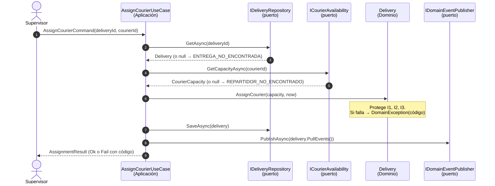
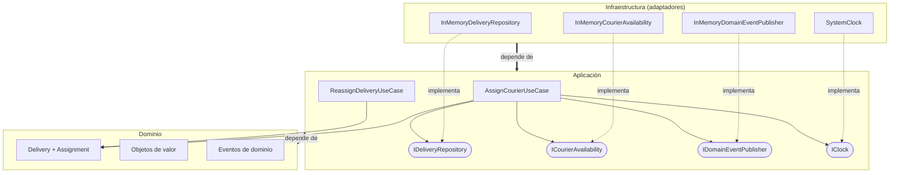

# 6. Casos de uso, puertos y adaptadores

## Casos de uso del contexto Entregas

| Caso de uso | Intención | Estado en el repositorio |
|---|---|---|
| **AssignCourierUseCase** | Asignar un repartidor a una entrega pendiente | ✅ Implementado y probado |
| **ReassignDeliveryUseCase** | Cambiar el repartidor por una contingencia, con motivo | ✅ Implementado y probado |
| CreateDeliveryFromOrder | Crear la entrega cuando llega `PedidoConfirmado` | Diseñado (`Delivery.Create`); el consumidor del evento va en la Actividad 4 |
| StartRoute | El repartidor sale a ruta | Regla en el dominio; caso de uso en la Actividad 4 |
| CompleteDelivery | Registrar la entrega con evidencia | Regla en el dominio; caso de uso en la Actividad 4 |
| ReportFailedDelivery | Registrar una entrega fallida y reprogramarla | Regla en el dominio; caso de uso en la Actividad 4 |

## AssignCourierUseCase paso a paso

| Paso de la guía | En el código |
|---|---|
| 1. Cargar la entrega mediante `IDeliveryRepository` | `deliveries.GetAsync(...)` |
| 2. Verificar que exista y no tenga repartidor activo | `null` → `ENTREGA_NO_ENCONTRADA`; "sin repartidor activo" lo verifica la entidad (I1) |
| 3. Consultar la disponibilidad mediante un puerto | `couriers.GetCapacityAsync(...)` (`ICourierAvailability`) |
| 4. `delivery.AssignCourier(...)` protege la invariante | La entidad lanza `DomainException` con un código, y el caso de uso lo convierte en `AssignmentResult.Fail` |
| 5. Guardar mediante el repositorio | `deliveries.SaveAsync(delivery)` |
| 6. Publicar o registrar el resultado mediante un adaptador | `events.PublishAsync(delivery.PullEvents())` |

**El caso de uso coordina, pero no decide.** No tiene ningún `if` de reglas de negocio: recibe sus dependencias **por constructor**, todas son **interfaces**, y no crea `SqlConnection` ni `HttpClient`. Ver [`AssignCourierUseCase.cs`](../../src/Logistica.Entregas.Application/UseCases/AssignCourierUseCase.cs).

## Puertos y adaptadores

| Puerto (interfaz, en Aplicación) | Qué necesita el caso de uso | Adaptador hoy (Infraestructura) | Adaptador en la Actividad 4 |
|---|---|---|---|
| `IDeliveryRepository` | Cargar y guardar entregas | `InMemoryDeliveryRepository` | Repositorio SQL (SQL Server / PostgreSQL) con columna de versión |
| `ICourierAvailability` | Saber si un repartidor está en turno y su carga | `InMemoryCourierAvailability` | Cliente HTTP al servicio de turnos, con timeout y capa anticorrupción |
| `IDomainEventPublisher` | Avisar a Notificaciones y Auditoría | `InMemoryDomainEventPublisher` | Outbox en la base de datos + cola de mensajes |
| `IClock` | Saber la fecha y hora actuales | `SystemClock` | El mismo |
| *(entrada)* Casos de uso | Recibir la intención del usuario | Pruebas automáticas | Controlador HTTP `POST /api/v1/deliveries/{id}/assignment` |

## Capas y dirección de las dependencias

Se usan **tres capas** (más las pruebas), como recomienda la guía. Son tres porque cada una cambia por una razón distinta:

| Capa | Proyecto | Contiene | Cambia cuando… |
|---|---|---|---|
| **Dominio** | `Logistica.Entregas.Domain` | Entidades, objetos de valor, invariantes, eventos | Cambia una **regla del negocio** |
| **Aplicación** | `Logistica.Entregas.Application` | Casos de uso, contratos (comandos/resultados), puertos | Cambia **lo que el usuario quiere hacer** |
| **Infraestructura** | `Logistica.Entregas.Infrastructure` | Adaptadores: repositorio, disponibilidad, eventos, reloj | Cambia **una tecnología** (base de datos, proveedor, cola) |

**Regla de dependencias.** Las flechas siempre apuntan **hacia adentro**: Infraestructura → Aplicación → Dominio. El dominio **no referencia ningún proyecto ni paquete**. Eso no queda solo dicho: lo comprueban las pruebas de arquitectura en [`DependencyRulesTests.cs`](../../tests/Logistica.Entregas.Tests/Architecture/DependencyRulesTests.cs):
- el dominio no depende de ninguna otra capa;
- la aplicación solo depende del dominio;
- cada puerto tiene un adaptador;
- el dominio no usa tipos de bases de datos, HTTP ni archivos.

## SOLID aplicado

| Principio | Dónde se ve |
|---|---|
| **S**: responsabilidad única | La entidad decide; el caso de uso coordina; el adaptador persiste |
| **O**: abierto/cerrado | Se puede agregar un adaptador SQL sin modificar el caso de uso |
| **L**: sustitución de Liskov | Cualquier implementación de `IDeliveryRepository` sirve (en memoria o SQL) |
| **I**: segregación de interfaces | Puertos pequeños y específicos (`ICourierAvailability` solo da capacidad, no el perfil completo del repartidor) |
| **D**: inversión de dependencias | Aplicación define las interfaces; Infraestructura las implementa |
