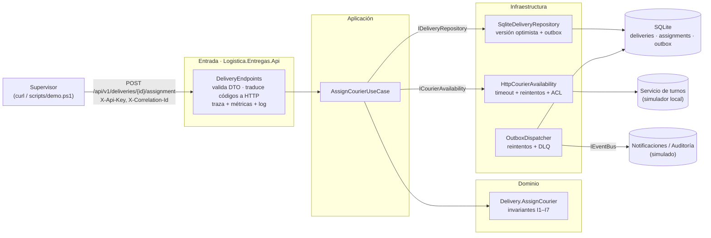

# 1. Implementación del vertical slice: asignar una entrega

> Actividad 4 · Construcción, validación y defensa final
> Implementa el flujo diseñado en la [Actividad 3](../actividad-3/01-flujo-asignar-entrega.md), de punta a punta: **entrada HTTP → caso de uso → dominio → persistencia SQLite → outbox → integración externa**.

## Recorrido por las capas



| Capa | Proyecto | Qué hace en este flujo |
|---|---|---|
| **Entrada** | `src/Logistica.Entregas.Api` | Endpoints REST, DTOs, validación de formato, clave de API, id de correlación, traducción de códigos de error a HTTP, salud |
| **Aplicación** | `src/Logistica.Entregas.Application` | `CreateDeliveryUseCase`, `AssignCourierUseCase`, `ReassignDeliveryUseCase`, `GetDeliveryQuery`; contratos y puertos |
| **Dominio** | `src/Logistica.Entregas.Domain` | `Delivery` protege las invariantes. Lo único que cambió es que se agregó `Restore` para reconstruir desde la base de datos |
| **Infraestructura** | `src/Logistica.Entregas.Infrastructure` | Repositorio SQLite, migraciones versionadas, adaptador HTTP del servicio de turnos, outbox con despachador y DLQ, telemetría |

## Endpoints

| Método y ruta | Caso de uso | Respuestas |
|---|---|---|
| `POST /api/v1/deliveries` | Crear la entrega de un pedido confirmado | `201` · `400` validación · `422` regla |
| `GET /api/v1/deliveries/{id}` | Consultar el estado y el historial (sin la dirección) | `200` · `404` |
| `POST /api/v1/deliveries/{id}/assignment` | **Asignar un repartidor** | `200` · `400` · `404` · `409` · `422` · `503` |
| `POST /api/v1/deliveries/{id}/reassignment` | Reasignar con motivo (contingencia) | `200` · `400` · `404` · `409` · `422` · `503` |
| `GET /health` | Salud: base de datos, eventos pendientes, mensajes fallidos | `200` · `503` |
| `GET/POST /simulador/...` | Simulador del servicio de turnos y de fallas (**solo en Development**) | — |

Todos los endpoints `/api` exigen la cabecera `X-Api-Key`. Todas las respuestas llevan `X-Correlation-Id`.

### Traducción de errores a HTTP

| Código del caso de uso | HTTP | Qué significa para quien llama |
|---|:-:|---|
| `ENTREGA_NO_ENCONTRADA`, `REPARTIDOR_NO_ENCONTRADO` | 404 | Revise el identificador |
| `ENTREGA_YA_ASIGNADA`, `ESTADO_NO_PERMITE_OPERACION`, `MISMO_REPARTIDOR`, `CONFLICTO_CONCURRENCIA` | 409 | El estado actual no lo permite; consulte la entrega y decida |
| `REPARTIDOR_SATURADO`, `REPARTIDOR_NO_DISPONIBLE`, `MOTIVO_OBLIGATORIO`, `VALOR_INVALIDO` | 422 | La regla de negocio lo rechaza |
| `SERVICIO_REPARTIDORES_NO_DISPONIBLE` | 503 | Falla temporal de un sistema externo; reintente más tarde |

El cuerpo es `ProblemDetails` (RFC 7807) con `code`, `deliveryId` y `correlationId`. **Nunca incluye trazas internas.**

## Cómo ejecutarlo

Requisito: [.NET SDK 10](https://dotnet.microsoft.com/download).

```bash
dotnet run --project src/Logistica.Entregas.Api
```

Al iniciar, la API:
1. **aplica las migraciones** (crea `entregas.db` si no existe);
2. levanta el **despachador del outbox**;
3. levanta el **simulador** en `http://localhost:5080`.

En otra terminal, la demostración completa:

```powershell
./scripts/demo.ps1
```

O a mano:

```bash
curl -s -X POST http://localhost:5080/api/v1/deliveries -H "X-Api-Key: clave-local-solo-desarrollo" -H "Content-Type: application/json" -d "{\"orderId\":\"8c1e7f1a-0000-0000-0000-000000000001\",\"address\":\"Carrera 50 # 10-30\",\"windowStart\":\"2026-11-08T15:00:00Z\",\"windowEnd\":\"2026-11-08T17:00:00Z\"}"
curl -s -X POST http://localhost:5080/api/v1/deliveries/{id}/assignment -H "X-Api-Key: clave-local-solo-desarrollo" -H "Content-Type: application/json" -d "{\"courierId\":\"11111111-1111-1111-1111-111111111111\"}"
```

> La clave `clave-local-solo-desarrollo` solo existe en `appsettings.Development.json`. En cualquier otro entorno la clave se entrega por la variable de entorno `Seguridad__ApiKey`. Sin clave configurada, la API rechaza todo.

## Trazabilidad diseño (Act. 3) → implementación (Act. 4)

| Diseño de la Actividad 3 | Implementación |
|---|---|
| `AssignCourierUseCase`, los 6 pasos de la guía | [`AssignCourierUseCase.cs`](../../src/Logistica.Entregas.Application/UseCases/AssignCourierUseCase.cs), sin cambios en la lógica |
| Invariantes I1–I7 en `Delivery` | Sin cambios. I1 tiene además una segunda línea de defensa en la base de datos (índice único `ux_assignments_one_active`) |
| Puerto `IDeliveryRepository` | `SqliteDeliveryRepository` (real) e `InMemoryDeliveryRepository` (pruebas) |
| Puerto `ICourierAvailability` + capa anticorrupción | `HttpCourierAvailability`: toma activo, carga y máximo, e ignora la `ubicacion` del sistema externo |
| Evento `RepartidorAsignado` / `EntregaReasignada` | Contrato JSON del doc. 05 de la Act. 3, serializado en el outbox |
| Riesgo "concurrencia" (ADR-002) | Columna `version` + `ConcurrencyConflictException` → `409 CONFLICTO_CONCURRENCIA` |
| Riesgo "evento perdido" (ADR-002) | Outbox en la misma transacción + despachador con reintentos y DLQ |
| Controlador HTTP (componente C4 de la Act. 3) | `DeliveryEndpoints` (Minimal API) |

## Decisiones de implementación que ajustan el diseño de la Actividad 3

Todas están registradas en el **[ADR-003](../adr/ADR-003-implementacion-persistencia-integracion.md)**:

1. **`IDeliveryRepository.SaveAsync` recibe también los eventos, y desaparece el puerto `IDomainEventPublisher`.** Así la entrega y sus eventos se guardan en **una sola transacción** (outbox). Antes, guardar y publicar eran dos pasos que podían quedar a medias.
2. **Se agregó `AddAsync`** para las entregas nuevas, separado de `SaveAsync`, que es el que aplica el control de versión.
3. **Se agregó `Delivery.Restore`** para reconstruir el agregado desde la base de datos sin generar eventos. Rechaza un estado guardado con dos asignaciones activas.
4. **La versión de concurrencia vive en el repositorio**, no en la entidad, para no meter detalles de persistencia en el dominio.
5. **Se agregaron los casos de uso `CreateDeliveryUseCase` y `GetDeliveryQuery`**, necesarios para que el flujo se pueda ejecutar y comprobar de punta a punta.
